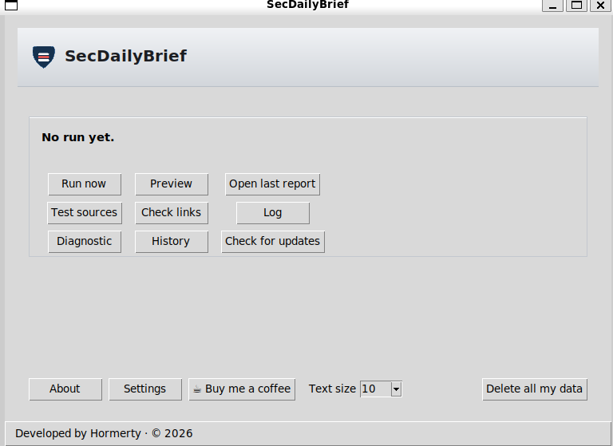
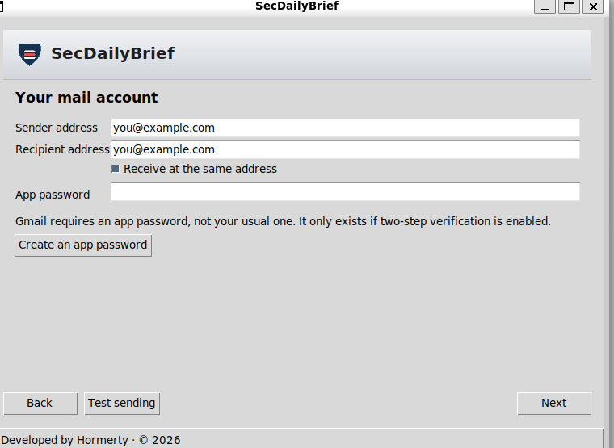

# SecDailyBrief

[](https://github.com/Hormerty/SecDailyBrief/actions/workflows/tests.yml)
[](https://github.com/Hormerty/SecDailyBrief/releases/latest)
[](LICENSE)
[](#installation)
[](#what-it-does)

**124 feeds in, one e-mail out. Every line traced to its source.**



## Contents

- [What it does](#what-it-does)
- [Why not an RSS reader?](#why-not-an-rss-reader)
- [Connecting the alert channels](docs/ALERTES.md)
- [Installation](#installation)
- [Principles](#principles)
- [Development](#development): [packaging](#packaging), [versioning](#versioning),
  [continuous integration](#continuous-integration), [encoding](#encoding)
- [Licence](#licence)

## What it does

- **124 sources**, including **20 national CERTs**: CERT-FR, CERT-EU, NCSC, BSI, CSIRT Italia,
  INCIBE, CERT.at, NSM, NCSC-FI, NKI, DNSC, SK-CERT and more. Foreign advisory titles are
  **translated to English** by tables written from real titles, not guessed vocabulary.
- **Exposure, not just severity**: every CISA KEV entry carries its **remediation deadline**,
  and the forty highest-scoring CVEs of a run are enriched with the **CISA SSVC decision**
  (exploitation, automatable, technical impact) before ranking.
- **Your stack first**: the products you list drive the ranking. A flaw in your firewall
  outranks a theoretical one elsewhere.
- **Cross-checked, not merely aggregated.** When three independent sources report the same CVE,
  the brief says so (`3 sources`) and raises its rank; a CVE carried by one feed alone is not
  presented as if three outlets had confirmed it. A source that stops answering is counted and
  named in the report rather than silently dropped.
- **Alerts within three hours**, by e-mail, Slack, Discord or Telegram, on top of the daily
  report, and each channel is a checkbox. Each address field explains itself: hover for one
  sentence, click for the step-by-step guide in [docs/ALERTES.md](docs/ALERTES.md).
- **Nine interface languages**: French, English, Dutch, German, Spanish, Italian, Portuguese,
  Hindi, Chinese.
- **Windows and Linux**, both built and tested in CI, and the Linux build verified by hand.

The engine itself lives in [`Sec_Daily_report-`](https://github.com/Hormerty/Sec_Daily_report-)
and is used here **without modifying it**: fetched at a pinned commit, checksummed, and
configured from the outside. [`SOURCES.md`](https://github.com/Hormerty/Sec_Daily_report-/blob/main/SOURCES.md)
lists every source, and every candidate examined and refused with its measurements.

The program does not run continuously: it wakes up, works for one to two minutes, then
stops. No account, no intermediary server, no telemetry.

## Why not an RSS reader?

You could follow the same feeds in Inoreader or FreshRSS. Three things would be missing.

- **The titles stay in their original language.** A CERT-FR advisory arrives in French, a
  SI-CERT one in Slovenian, a SK-CERT one in Slovak. A reader shows them as published; this
  program rewrites the advisory formulas from tables written on real titles, so a product name
  survives, and translates the dates inside the title too.
- **"Known exploited" is not a date.** Every CISA KEV entry carries its remediation deadline, and
  the ranking uses the CISA SSVC decision (exploitation, automatable, technical impact) rather
  than publication order.
- **A feed does not know your stack.** The products you list decide what rises to the first
  screen, and an advisory touching one of them triggers an alert within three hours instead of
  waiting for the morning.

A reader shows you everything and lets you decide. This program decides what deserves the first
screen and says why.

## Installation

1. Download an archive from the [published releases](../../releases/latest): `win64` or
   `linux-x86_64`, each in a normal and a portable variant.
2. Extract it wherever you like, then run `SecDailyBrief` (`SecDailyBrief.exe` on Windows).
3. The wizard asks for your language, your sending address and an app password, not your usual
   password. For Gmail: <https://myaccount.google.com/apppasswords>.
4. **Test sending** checks the configuration before saving it, then **Finish** creates the
   scheduled task, either the Windows Task Scheduler or a systemd timer on Linux.



## Principles

- **Nothing is changed on the engine side.** `vendor/veille.py` is downloaded at a precise SHA
  and watched by a checksum; the stack and the configuration are injected from the
  application, before `main()` is called.
- **No monitoring of your machine.** The application reads public feeds and sends an e-mail.
  It reads no document, captures nothing, and transmits nothing to its author.
- **Your settings stay with you**, in `%APPDATA%\SecDailyBrief` on Windows and
  `~/.local/share/SecDailyBrief` on Linux, and are erased from the application itself.

## Development

```bash
python -m venv .venv
.venv\Scripts\python.exe -m pip install -r requirements.txt -r requirements-dev.txt

.venv\Scripts\python.exe tools\fetch_engine.py --sha <commit>   # fetch the pinned engine
.venv\Scripts\python.exe tools\fetch_engine.py --verify         # replay the checksum check

.venv\Scripts\python.exe -m pytest -q
```

### Packaging

Windows:

```powershell
powershell -NoProfile -ExecutionPolicy Bypass -File build\build.ps1
```

Linux, on a machine whose glibc is no newer than the oldest target:

```bash
PYTHON=python bash build/build.sh
```

A frozen binary requires the glibc of the machine that built it. Built on Ubuntu 26.04 (2.42), the
archive refused to start on Debian 13 (2.41), which is [issue #5](https://github.com/Hormerty/SecDailyBrief/issues/5).
CI therefore builds on ubuntu-22.04, and `SDB_GLIBC_MAX` makes the script fail when a built binary
asks for more than that ceiling, so a runner upgrade breaks the build instead of the first launch.

The script first verifies the engine checksum (a binary embedding an altered engine would be
undetectable once shipped), then produces `dist\SecDailyBrief\` and **two** archives: a normal one,
and a portable one whose `portable.flag` file moves the data into a `data\` folder beside the
executable. Both contain the executable, `README.txt`, `uninstall.ps1`, `LICENSE` and
`CHANGELOG.md`.

The script refuses to build if the three version declarations disagree: the package, the
Windows properties of the `.exe` file, and `pyproject.toml`.

### Versioning

Changes accumulate in an ## Unreleased section at the top of CHANGELOG.md. When a version is
cut, that section becomes the release notes and an empty one takes its place: nothing is lost
between two tags, and nobody has to reconstruct what happened.

Three numbers, one rule each:

| Bump | When | Command |
|---|---|---|
| **patch** (`1.4.0` → `1.4.1`) | a fix, or added translations | `tools/bump_version.py patch` |
| **minor** (`1.4.1` → `1.5.0`) | a new visible capability | `tools/bump_version.py minor` |
| **major** (`1.5.0` → `2.0.0`) | a change that breaks existing data or configuration | `tools/bump_version.py major` |

Language additions are patches, not minor releases: the interface gains a dictionary, the
program does not change.

```powershell
.venv\Scripts\python.exe tools\bump_version.py patch --dry-run
.venv\Scripts\python.exe tools\bump_version.py patch
```

The script writes the version in all four places that carry it: the package, `pyproject.toml`,
the Windows properties of the executable, and the title of the archive README. Hand-editing
those four is how 1.2.0 shipped with a README announcing 1.1.0.

### Continuous integration

Two workflows live in `.github/workflows/`:

- **`tests.yml`** runs the suite on every push and pull request, on Windows and Linux, after
  checking the engine checksum.
- **`release.yml`** runs on a `v*` tag: it rebuilds the four archives on two runners (Windows and
  Ubuntu 22.04), refuses to continue when the tag and the package version disagree, and attaches
  them to the release with a `SHA256SUMS` file.

Publishing therefore does not depend on a particular workstation. `SDB_PYTHON` and
`SDB_SORTIE` let `build.ps1` use another interpreter and write elsewhere.

### Encoding

Everything is read and written as explicit UTF-8. Two traps met for real, and how each was
handled:

- **Windows PowerShell 5.1**, the one Windows still ships, reads and writes ANSI by
  default. A `Get-Content` / `Set-Content` round trip on a UTF-8 file corrupts it
  (`é` becomes `é`). A source file is never rewritten through this shell: use an editor, or
  an explicit `-Encoding UTF8`.
- **The BOM**: Notepad and `Out-File` produce one, and `json` rejects it. The configuration
  file is therefore read as `utf-8-sig`, which accepts it as well as its absence.

In the code, every `read_text` / `write_text` carries its encoding, and console output goes
through `PYTHONIOENCODING=utf-8` whenever it contains anything beyond ASCII.

## Licence

MIT : see `LICENSE`.

Developed by Hormerty · © 2026
