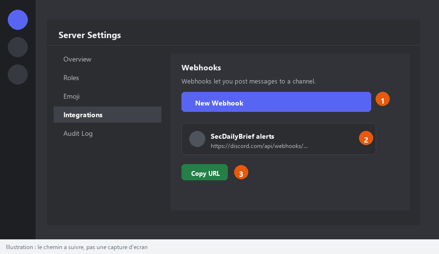
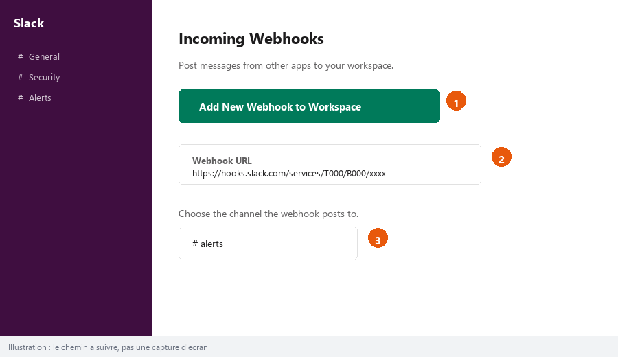
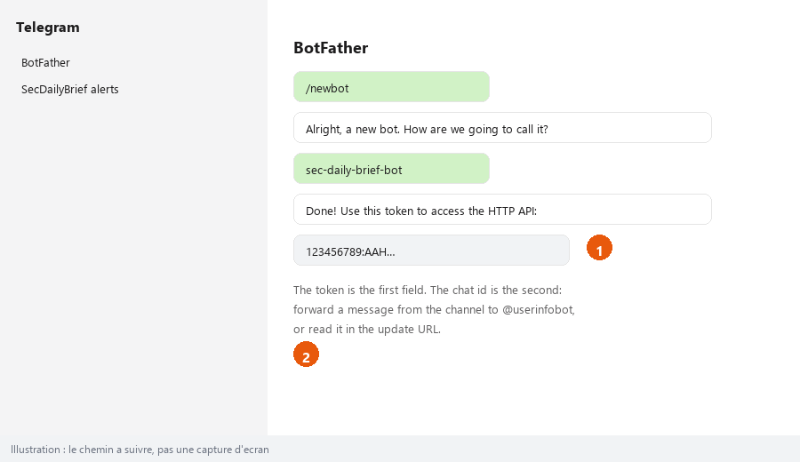

# Alert channels: where the addresses come from

The daily report always goes by e-mail. The **immediate alerts** can also be posted to Discord,
Slack or Telegram, and each channel is a checkbox in **Alerts** (or at the end of the setup
wizard).

This page explains what to paste in each field. The images below are **illustrations**, not
screenshots: the menus move between versions, the steps do not.

Where do these addresses go? Not into `config.json`. A webhook URL is a credential: anyone who
holds it can post to your channel: so it is stored in the encrypted file that also holds your
mail password, and it never leaves your machine.

---

## Discord



1. Open the server where the alerts should arrive, then **Server Settings**.
2. In the left column, choose **Integrations**, then **Webhooks**, then **New Webhook** ①.
3. Give it a name (`SecDailyBrief alerts`), and pick the channel it posts to.
4. Click **Copy URL** ③. The address looks like
   `https://discord.com/api/webhooks/123456789/AbCdEf…`.

Paste that whole address into the Discord field. It is not a channel link and not an invite: if
what you copied starts with `https://discord.gg/`, it is the wrong thing.

Permissions needed: **Manage Webhooks** on that channel. You do not need to be the server owner.

---

## Slack



1. Go to <https://api.slack.com/apps>, create an app (or pick an existing one).
2. In the app, open **Incoming Webhooks** and turn the feature on.
3. Click **Add New Webhook to Workspace** ①, then choose the channel ③.
4. Slack shows a URL like `https://hooks.slack.com/services/T00000000/B00000000/XXXXXXXX`.

Paste that address into the Slack field. It is tied to the channel you picked: to post in two
channels, create two webhooks and two entries, or use a channel that forwards.

A Slack *incoming webhook* URL is enough. You do not need a bot token, and you do not need to
publish the app.

---

## Telegram



Telegram needs **two** values, which is why this field has two boxes.

1. Open a chat with **@BotFather**, send `/newbot` ①, choose a name and a username ending in
   `bot`. BotFather answers with a token like `123456789:AAH…`. That is the **first box**.
2. The **second box** is the chat identifier. The simplest way to get it: add your bot to the
   channel or group, post a message there, then open
   `https://api.telegram.org/bot<your-token>/getUpdates` in a browser and read
   `"chat":{"id":-1001234567890, …`. Private chats have a positive id, groups and channels a
   negative one, starting with `-100` for supergroups ②.
3. Send your bot a message once, or it cannot write to you: a bot can never start a conversation.

If the token is wrong, Telegram answers `401 Unauthorized`. If the bot is not in the chat, it
answers `403 Forbidden`: the two errors mean different things.

---

## Checking that it works

The application checks your mail settings with **Test sending**, but it has no equivalent for the
discussion channels. Until one exists, an alert is only sent when something matches your stack,
which can take days.

To try it now, from a terminal, with the engine at hand:

```bash
SLACK_WEBHOOK="https://hooks.slack.com/services/…" python veille.py --alerte
```

The engine sends whatever it considers a major flaw; if nothing has changed since the last sweep,
it says so and sends nothing. That is the normal behaviour, not a failure.

## If a webhook leaks

Delete it at the source: **Discord** → Integrations → Webhooks → your entry → *Delete*;
**Slack** → your app → Incoming Webhooks → *Remove*; **Telegram** → @BotFather → `/revoke`.
The old address stops working immediately, and the application reports the channel as failing in
the next report.
